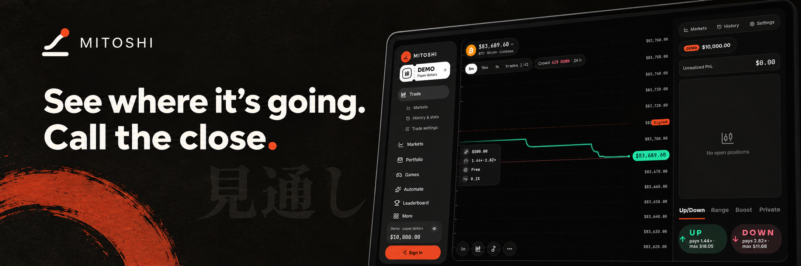
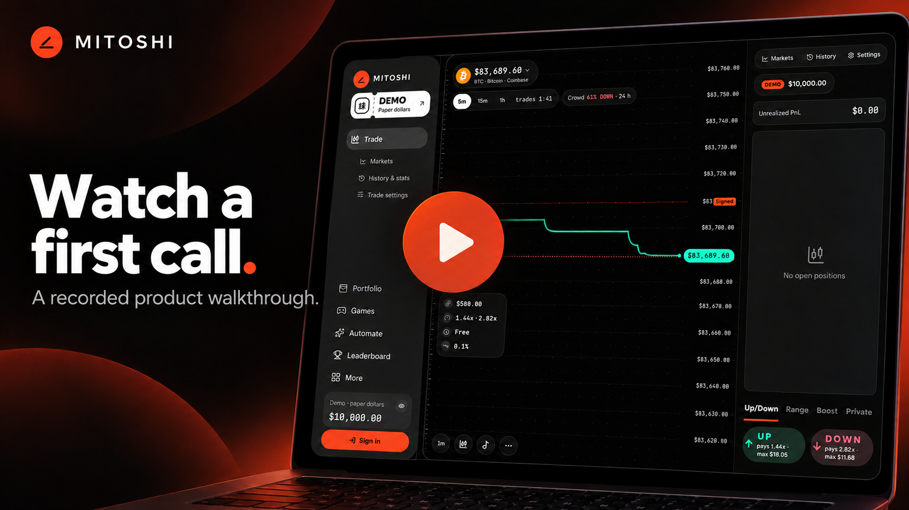

<p align="center">
  <a href="https://mitoshi.xyz">
    
  </a>
</p>

<h1 align="center">Mitoshi · 見通し</h1>
<p align="center">See where it's going. Call the close.<br/>Short price predictions on crypto and US stocks, built on Tempo.</p>

<p align="center">
  <a href="https://mitoshi.xyz"><b>Open the app</b></a>
  &nbsp;·&nbsp;
  <a href="https://mitoshi.xyz/demo"><b>Product demo</b></a>
  &nbsp;·&nbsp;
  <a href="https://mitoshi.xyz/video"><b>Watch the film</b></a>
  &nbsp;·&nbsp;
  <a href="https://mitoshi.xyz/download"><b>Get the app</b></a>
  &nbsp;·&nbsp;
  <a href="https://mitoshi.xyz/proof"><b>Settlement proof</b></a>
  &nbsp;·&nbsp;
  <a href="https://docs.mitoshi.xyz"><b>Guides</b></a>
</p>

**Mitoshi is a prediction market on Tempo testnet.** Choose a fixed-time **Window**, call whether a crypto or stock price will close UP or DOWN, and follow the signed opening and closing prints through to its result. You can explore with paper dollars in the browser or create a passkey account for testnet trades. Testnet pathUSD has no cash value. Mitoshi is not deployed on Tempo mainnet.

Built for Colosseum's **Crypto World's Fair · Tempo track**. *Mitoshi* (見通し) means seeing what lies ahead.

## Watch it work

<p align="center">
  <a href="https://mitoshi.xyz/demo">
    
  </a>
</p>

[**Open the product demo**](https://mitoshi.xyz/demo) to watch a 20-second recording of the signed-out paper trading flow, then inspect linked claims and Tempo receipts. The recording shows an actual browser session captured on 13 October 2026; a paper call does not send an onchain transaction. The banner and cover are editorial artwork based on dated app captures. The separate [30-second Mitoshi film](https://mitoshi.xyz/video) introduces the idea; it is a motion graphic, not transaction evidence. An official YouTube product demo has not been published yet.

## Make a call

1. Open [the BTC terminal](https://mitoshi.xyz/trade/BTC). Signed out, you can use paper dollars on live prices without a wallet.
2. Read the Window's opening line, close time, quote and possible payout before choosing **UP** or **DOWN**. UP wins when the signed close is at or above the signed open; DOWN wins below it.
3. Follow a position in [Portfolio](https://mitoshi.xyz/portfolio). You can close at an available book quote or wait for the Window's result, then inspect the [proof](https://mitoshi.xyz/proof).

For a testnet trade, create an account with a passkey and use the provided test dollars. [Make your first call](https://docs.mitoshi.xyz/start/quickstart) explains the complete flow and the distinction between paper and testnet activity.

| Explore | What you can do | Start here |
| --- | --- | --- |
| **Trade** | Call short crypto and stock Windows; inspect the quote, position and result. | [Markets](https://mitoshi.xyz/markets) · [Trading guide](https://docs.mitoshi.xyz/trading/windows) |
| **Play** | Try Practice and other games built around the same price movements. | [Games](https://mitoshi.xyz/games) · [Game guides](https://docs.mitoshi.xyz/games/overview) |
| **Automate** | Explore strategies and agents with explicit spending limits. | [Agents](https://mitoshi.xyz/agents) · [Automation guides](https://docs.mitoshi.xyz/automate/overview) |
| **Verify** | Read signed prints, settlement details and transaction links. | [Proof](https://mitoshi.xyz/proof) · [Evidence guide](https://docs.mitoshi.xyz/help/evidence) |

## Get the app

[Get the app](https://mitoshi.xyz/download) shows the current iPhone, Android and web options. The web app is usable in a browser and can be installed from supported browsers. The native iOS and Android builds have separate store-testing gates; check the download page for their current availability rather than assuming a store listing is open.

## How it works

The Tempo contracts hold test collateral, keep each Window's order book, record admissible signed price prints, and settle or void according to the registered rules. The web app, mobile shell, and operations service use shared market rules; the [architecture guide](https://docs.mitoshi.xyz/architecture/overview) maps what each part can control. [Who can do what](https://docs.mitoshi.xyz/safety/who-can-do-what) explains the signing and operator boundaries.

**Verification has a date and a scope.** The [evidence guide](https://docs.mitoshi.xyz/help/evidence) links recorded testnet transactions and calls out limits. [Availability](https://docs.mitoshi.xyz/help/availability) separates usable paths from work awaiting store, provider, or owner setup. [Live status](https://mitoshi.xyz/status) shows service health when you visit.

## Run it locally

Use Node.js 24+ and pnpm 11.24.0.

```sh
pnpm install --frozen-lockfile
pnpm dev
```

`pnpm dev` starts the web app. Public browsing and paper trading are the easiest first paths; funded testnet actions and always-on services need the configuration described in the [local setup guide](https://docs.mitoshi.xyz/builders/local-setup). Environment examples in [`infra/env`](infra/env) list required names without values.

```sh
pnpm typecheck
pnpm invariants
pnpm test
pnpm contracts:build
pnpm contracts:test
```

The guide site is its own pnpm project in [`docs-site`](docs-site). Run `pnpm install` and `pnpm dev` there to work on the public documentation.

## Find the source

| Area | Directory |
| --- | --- |
| Tempo contracts and deployment fragments | [`contracts`](contracts) |
| Shared rules, market access, generated clients and persistence | [`packages`](packages) |
| Keepers and other long-running actors | [`services/ops`](services/ops) |
| Web app, `/demo` and `/video` | [`web`](web) |
| Native mobile shell | [`mobile`](mobile) |
| Public guides and architecture | [`docs-site`](docs-site) |

## Provenance

This entry adapts the owner's earlier **Masayume**, **Agari**, **Owarine** and **Baku** code. Ported files identify their original project and revision in source comments. The Tempo engine, product contracts, stock Windows, wallet and relay layer, operations keepers, and current Mitoshi product work were built for this project. See [`THIRD_PARTY_NOTICES.md`](THIRD_PARTY_NOTICES.md) for third-party materials and attribution.
